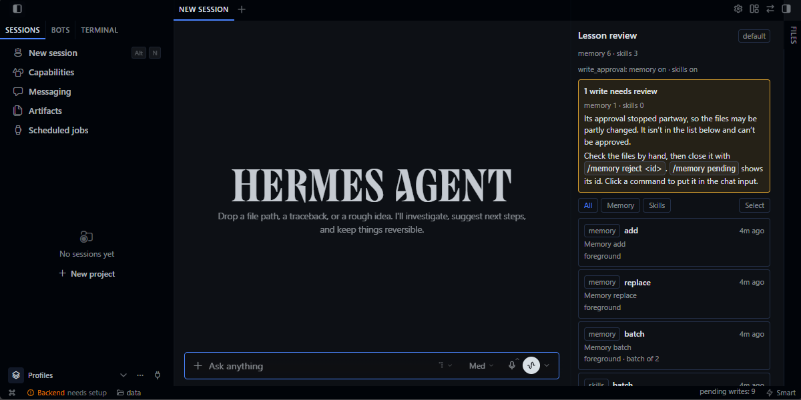
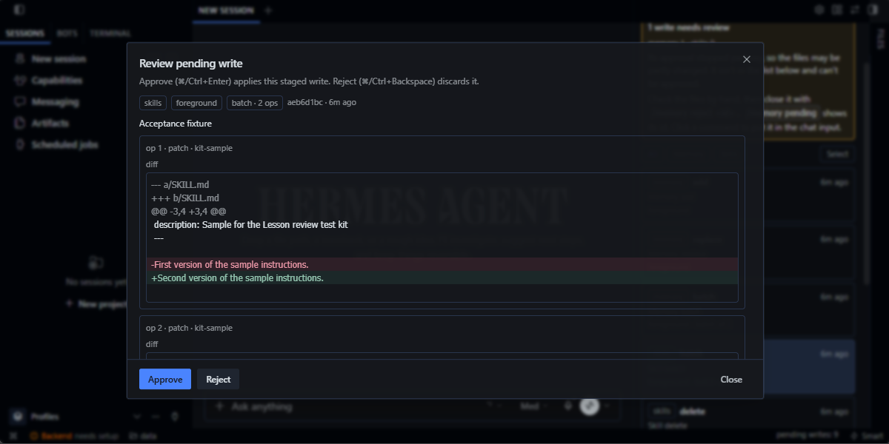

# Lesson review

Review staged memory and skill writes in Hermes Desktop. The pane lists metadata only; open a write to see the full proposal and any diffs before approving or rejecting it.

> [!IMPORTANT]
> **This plugin does not work on an unpatched Hermes release that lacks the Write Review API.**
> Wait for [Hermes Agent PR #158550](https://github.com/NousResearch/hermes-agent/pull/158550), or an alternative PR that provides the same `tools.write_review_api`, to be **merged and included in a Hermes release**. Upgrade the backend to that release before installing the plugin. To use it sooner, patch your own Hermes Agent checkout with the PR (or a compatible equivalent) and run your backend from that checkout. Updating Desktop alone is not enough.



## Install

On the Hermes backend that Desktop connects to, install and enable the plugin:

```bash
hermes plugins install weeix/hermes-write-review-plugin --enable
```

Restart that backend (`hermes gateway restart` if managed as a gateway service). Then enable `lesson-review` in Desktop under **Capabilities → Plugins**. The desktop pane is opt-in even when the backend plugin is enabled. The Webapp can also show the pane when hosted by a compatible backend.

Set `memory.write_approval` or `skills.write_approval` to `true` in the profile whose pending writes you want to review. These settings control what gets staged; turning them off does not clear the queue.



## Read-only review

Set `allow_decisions` to `false` in **Settings → Plugins**, or put the following in the profile's `config.yaml`:

```yaml
plugins:
  entries:
    lesson-review:
      settings:
        allow_decisions: false
```

An explicit value other than boolean `true`, or an unreadable config, disables decisions. If the setting is absent from `settings`, the plugin falls back to the legacy `config` subsection under the same entry. Set `LESSON_REVIEW_ALLOW_DECISIONS=0` on the backend to force read-only mode across all profiles; the environment cannot turn decisions on.

## Access and privacy

- Hermes authenticates and selects the profile before dispatching requests to the plugin. Anyone who can authenticate to the backend can select profiles enabled for their session; the dashboard session token is not a per-profile access boundary. Grant backend access only to people you trust to read staged content and, where decisions are enabled, act on it.
- The plugin never opens the pending store directly. Hermes supplies previews and handles approval or rejection. The plugin registers no agent tools, hooks, or middleware and makes no external network calls.

## Development

To use a local checkout, link it as `lesson-review` under the test profile's `plugins/` directory, then run `hermes plugins enable lesson-review` in that profile and restart its backend. Copying just `desktop/plugin.js` by hand does not install the backend or pair the two halves in Desktop.

`LESSON_REVIEW_ADAPTER=fake` serves fixtures without the Write Review API and never applies decisions. Clients calling the decision route must pass the preview's `expect` value unchanged and check the outcome: HTTP 200 alone does not mean the change was applied.

```bash
uv venv --python 3.14 .venv
uv pip install --python .venv/bin/python pytest fastapi httpx
env -u PYTHONPATH -u HERMES_SRC .venv/bin/python -m pytest -q
hermes plugins validate .

(cd tests/render && npm install)
.venv/bin/python tests/render/make-snapshot.py
(cd tests/render && WR_SNAPSHOT=.generated/snapshot.json npm test)
```

To include the mounted HTTP tests, set `HERMES_SRC` to a Hermes checkout that provides the Write Review API and `HERMES_PYTHON` to a Python interpreter with that checkout's dependencies. The tests use disposable profile data.

## License

[MIT](LICENSE)
